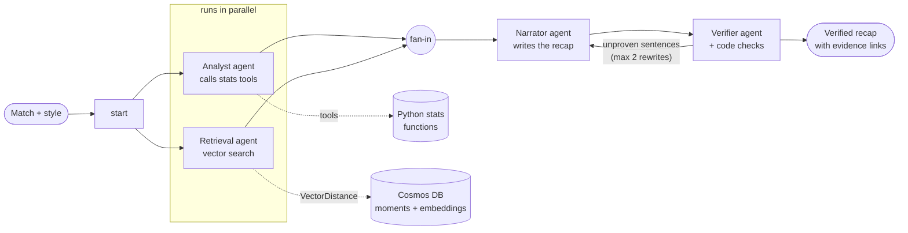

# Inside the Game

**Football match recaps where every sentence shows its proof.**

Four AI agents turn the raw event data of a (synthetic) football match into a readable recap, in a fan,
analyst or broadcaster voice, in English, Spanish, French, Portuguese or Hindi. Every sentence links to the evidence behind it: click it and you see the
events on a pitch, the statistics, or similar moments from other matches. A Verifier agent fact-checks
each sentence against that evidence and sends anything unproven back for a rewrite.

**Live demo:** https://gentle-mushroom-01796580f.4.azurestaticapps.net

Built for the Microsoft x Premier League Developer Hackathon with the
[Microsoft Agent Framework](https://github.com/microsoft/agent-framework), Microsoft Foundry and Azure.

> All teams, players and matches are **synthetic**. No real Premier League data, names or logos are used.

---

## How it works



The four agents run as one **Agent Framework workflow** ([workflow.py](inside_the_game/workflow.py)):

| Agent | Job | How it stays honest |
|---|---|---|
| **Analyst** | Finds what mattered: result, goals, lead changes, counterattacks, shots, possession | It never does arithmetic. It calls deterministic Python **tools** ([stats.py](inside_the_game/stats.py)) and cites the tool and `event_ids` behind each finding. Code rejects event ids that don't exist. |
| **Retrieval** | Compares this match's key moments with similar ones in other matches | Code describes each goal and counterattack in plain text, embeds it with `text-embedding-3-small`, and searches Cosmos DB with vector search. The agent cites moment ids; code rejects any id a search didn't return. |
| **Narrator** | Writes the recap in the chosen style | It only sees numbered findings, never event ids. Each sentence cites finding numbers, and **code** resolves them to the real evidence, so links can't be invented. |
| **Verifier** | Fact-checks every sentence | It sees only that sentence's own evidence (tool results, events, similar moments) and reasons before its verdict. Code checks add rules an LLM shouldn't be trusted with: no leaked internals, no overlong sentences, comparisons must name a real match. |

### Design principles

- **Numbers come from code, words come from AI.** Statistics are computed by tested Python functions; the
  models only choose and phrase them.
- **Evidence is attached by code, not by the model.** Agents cite ids, and code looks up the evidence, so every
  link in the UI points at real data.
- **Fail closed.** A sentence still unproven after two rewrites is removed (and logged); a failed headline falls
  back to the plain scoreline. If retrieval fails, the recap is still produced, just without comparisons.
- **Show the work.** The UI shows the agents running live, the evidence behind each sentence, and a fact-check
  log of everything the Verifier sent back.

## Azure services

| Service | Used for |
|---|---|
| **Microsoft Foundry** | `gpt-5.4-mini` for all four agents, `text-embedding-3-small` for moment embeddings |
| **Azure Cosmos DB** (NoSQL) | Matches, verified recaps, and moment embeddings with a vector index (`quantizedFlat`, cosine) |
| **Azure Container Apps** | The FastAPI backend, scaling to zero when idle |
| **Azure Static Web Apps** | The React UI, deployed by GitHub Actions |
| **Azure Container Registry** | The backend image |
| **Application Insights** | OpenTelemetry traces of every run: agents, tool calls, model calls with token counts, Cosmos calls |

No keys or secrets anywhere: the backend authenticates with a **managed identity** (Entra ID) to Cosmos DB
(key access disabled) and Foundry. Locally, the same code uses your `az login`.

## Run it locally

Prerequisites: Python 3.11, Node 20.19+, the Azure CLI (`az login`), a Microsoft Foundry project with
`gpt-5.4-mini` and `text-embedding-3-small` deployed, and a Cosmos DB account with vector search enabled
(database `insidethegame`; containers `matches`, `recaps` and `moments`, all partitioned by `/match_id`, with a
1536-dimension vector index on `/embedding` in `moments`).

```bash
python -m venv .venv && source .venv/bin/activate
pip install -e ".[dev]"
cp .env.example .env               # fill in your Foundry and Cosmos endpoints

python -m inside_the_game.moments --count 30        # generate 30 matches, embed their key moments
python -m inside_the_game.workflow --seed 5 --style fan   # run the agents on one match in the terminal

uvicorn inside_the_game.api:app --port 8000          # the API
cd frontend && npm install && npm run dev            # the UI on http://localhost:5173
```

Other useful commands:

| Command | What it does |
|---|---|
| `python -m inside_the_game.generator --count 5` | Write synthetic matches to `data/matches/` |
| `python -m inside_the_game.pregenerate --count 5` | Pre-generate recaps for the demo (add `--redo-removed` to retry ones that lost sentences, `--languages es fr` for other languages) |
| `python -m inside_the_game.workflow --diagram` | Print the workflow graph as Mermaid |
| `TRACING=1 python -m inside_the_game.workflow ...` | Send traces to Application Insights from your machine |
| `pytest` | 74 tests; no Azure or model calls needed |

## The data

[generator.py](inside_the_game/generator.py) simulates a match possession by possession from a seed, so the same
seed always gives the same match: about 1,200 events, 2.9 goals and 28 shots per match on average, with fast-break
counterattacks. Each event looks like this:

```json
{"event_id": 1042, "minute": 63, "team": "Home", "player": "H9", "type": "shot",
 "x": 88, "y": 41, "outcome": "goal", "possession_id": 211}
```

`x` and `y` run from 0 to 100, with `x` measured from the acting team's own goal toward the goal it attacks.

## API

The backend is a FastAPI app ([api.py](inside_the_game/api.py)) on Azure Container Apps.

- **Base URL:** `https://inside-the-game-api.ambitiousforest-f9db213d.eastus2.azurecontainerapps.io`
- **Interactive docs:** [`/docs`](https://inside-the-game-api.ambitiousforest-f9db213d.eastus2.azurecontainerapps.io/docs)
  (Swagger UI) and the OpenAPI schema at `/openapi.json`, both generated from the code.
- **Reading is open; generating is protected.** Every `GET` is public. The `POST` that runs the agents calls the
  AI models (it costs credit), so it needs the demo passcode in an `X-Recap-Passcode` header.
- **Errors** are JSON: `{"detail": "No match 'match_999'"}`.

| Method | Path | What it returns | Status codes |
|---|---|---|---|
| `GET` | `/api/health` | `{"status": "ok"}` | 200 |
| `GET` | `/api/matches` | Summary of every match, with the recaps already saved for it | 200 |
| `GET` | `/api/matches/{match_id}` | One match with all its events | 200, 404 |
| `GET` | `/api/matches/{match_id}/stats` | The stats tool results the agents saw | 200, 404 |
| `GET` | `/api/matches/{match_id}/recaps/{style}` | A saved, verified recap | 200, 404 (not generated yet), 422 (bad style or language) |
| `POST` | `/api/matches/{match_id}/recaps/{style}` | Runs the four agents; streams progress, then the recap | 200 (stream), 403 (passcode), 404, 422 |
| `GET` | `/api/matches/{match_id}/live/{style}` | Plays the match live: the overlay feed, with saved commentary if any (free, no AI) | 200 (stream), 404, 422 |
| `POST` | `/api/matches/{match_id}/live/{style}` | Plays it live while the Commentator and Verifier agents commentate; saves the run | 200 (stream), 403 (passcode), 404, 422 |

Path parameters: `match_id` is `match_001` … `match_030`; `style` is `fan`, `analyst` or `broadcaster`.
Both recap endpoints take an optional `?language=` query parameter: `en` (default), `es`, `fr`, `pt` or `hi`.
The Narrator writes in that language and the Verifier checks it against the same evidence; team names, player ids
and numbers stay exactly as in the data.

### `GET /api/matches`

```json
[{"match_id": "match_005", "home_team": "Ashvale Town", "away_team": "Harbourside City",
  "score": {"Home": 3, "Away": 2},
  "recaps": [{"style": "analyst", "language": "en"}, {"style": "fan", "language": "es"}, ...]}, ...]
```

### `GET /api/matches/{match_id}`

The match and all its events (about 1,200). The UI looks up a sentence's `event_ids` here.

```json
{"match_id": "match_005", "seed": 5, "home_team": "Ashvale Town", "away_team": "Harbourside City",
 "score": {"Home": 3, "Away": 2},
 "events": [{"event_id": 1, "minute": 0, "team": "Home", "player": "H9", "type": "kickoff",
             "x": 50, "y": 50, "outcome": "complete", "possession_id": 1}, ...]}
```

### `GET /api/matches/{match_id}/stats`

The exact results of the Analyst's tools, keyed by tool name. Sentences about totals cite these.

```json
{"get_match_info": {"home_team": "...", "away_team": "...", "final_score": {"Home": 3, "Away": 2}},
 "get_possession": {"Home": {"percent": 50.9, "passes_attempted": 484, "passes_completed": 402,
                             "pass_accuracy": 83.1}, "Away": {...}},
 "get_shots": {"Home": {"total": 16, "on_target": 9, "goals": 3, "saved": 6, "missed": 4, "blocked": 3,
                        "event_ids": [...]}, "Away": {...}},
 "get_goals": [{"event_id": 198, "minute": 16, "team": "Home", "player": "H10", "score_after": "1-0",
                "buildup_event_ids": [193, 194, 195, 196, 197, 198]}, ...],
 "get_counterattacks": [{"possession_id": 47, "team": "Home", "minute": 16, "won_by": "tackle",
                         "won_at_x": 49, "passes": 4, "outcome": "goal", "event_ids": [...]}, ...]}
```

### `GET /api/matches/{match_id}/recaps/{style}`

A verified recap. Every sentence carries its evidence: `event_ids` (moments in this match) and `tools`
(stats, or `find_similar_moments` for comparisons with other matches).

```json
{"recap": {"style": "fan", "language": "en",
           "headline": {"text": "Ashvale Town roared back to beat Harbourside City 3-2...",
                        "finding_ids": [1, 3], "event_ids": [833, 1024], "tools": ["get_match_info", "get_goals"]},
           "sentences": [{"text": "Ashvale Town led 1-0 through H10...", "finding_ids": [2],
                          "event_ids": [198, 667, 829], "tools": ["get_goals"]}, ...]},
 "comparisons": [{"claim": "...", "moment": {"moment_id": "match_005-p47", "minute": 16, "kind": "counterattack goal",
                                             "description": "..."},
                  "similar": [{"moment_id": "match_029-p120", "home_team": "Riverside Athletic",
                               "away_team": "Eastmoor United", "minute": 31, "similarity": 0.985, ...}],
                  "event_ids": [...]}],
 "rewrites": 1,
 "rejections": [{"draft": 0, "text": "...", "problem": "why the Verifier sent it back"}],
 "removed": [{"text": "...", "problem": "why it was dropped after the last rewrite"}]}
```

### `POST /api/matches/{match_id}/recaps/{style}`

Runs the workflow (Analyst and Retrieval in parallel, then Narrator and Verifier) and saves the result, replacing any
earlier recap for that match, style and language. It takes one to two minutes, so the response is a
[Server-Sent Events](https://developer.mozilla.org/docs/Web/API/Server-sent_events) stream:

```text
event: progress
data: {"step": "analyst", "status": "started", "detail": ""}

event: progress
data: {"step": "narrator", "status": "started", "detail": "rewrite 1"}

event: recap
data: { ...the same verified recap as the GET above... }
```

- `progress`: a step started or finished. `step` is `start`, `analyst`, `retrieval`, `narrator` or `verifier`;
  `detail` says which rewrite the Narrator is on.
- `recap`: the final verified recap (sent once, at the end).
- `error`: `{"detail": "..."}` if the run failed.

```bash
curl -N -X POST -H "X-Recap-Passcode: <passcode>" \
  https://inside-the-game-api.ambitiousforest-f9db213d.eastus2.azurecontainerapps.io/api/matches/match_007/recaps/fan
```

Without the right passcode the server answers `403 {"detail": "Generating recaps needs the demo passcode"}`.
Browsers can only call the API from the deployed UI and `http://localhost:5173` (CORS).

### Live mode: `GET` / `POST /api/matches/{match_id}/live/{style}`

Plays the match minute by minute, as if its events were arriving now. Every minute the backend ingests that minute's
events, recomputes the stats on everything so far (the same deterministic tools the Analyst uses) and detects key
moments. Nothing from later in the match is ever used. Query parameters: `language` (as above) and
`seconds_per_minute` (0–5, default 1: a match plays in about a minute and a half).

- `GET` is free for everyone: live stats from code, plus commentary from an earlier run if one is saved.
- `POST` (needs the passcode) has the **Commentator** agent explain each moment in one or two sentences, and the
  **Verifier** check them against the evidence *as of that minute*: one rewrite, then anything unproven is dropped.
  The clock never waits for the agents: commentary follows its moment a little later. The run is saved, so later
  `GET`s replay it for free.

The response is a timed, machine-readable **overlay feed** (Server-Sent Events): every message carries its match
minute, so it can drive on-screen graphics alongside a match.

```text
event: start       {"match_id": "match_002", "style": "broadcaster", "language": "en", "commentary": "saved"}
event: tick        {"minute": 16, "score": {"Home": 2, "Away": 1}, "possession": {"Home": 45.4, "Away": 54.6},
                    "passes_completed": {...}, "shots": {...}, "on_target": {...}, "events": [ ...this minute... ]}
event: moment      {"key": "goal-188", "kind": "goal", "minute": 16, "team": "Away", "event_ids": [180, ..., 188]}
event: commentary  {"moment": {...}, "sentences": [{"text": "A6 pulls one back...", "event_ids": [...],
                    "tools": ["get_goals"]}], "stats": { ...tool results at that minute... }, "rewrites": 0,
                    "removed": []}
event: done        {"minute": 91, "score": {"Home": 2, "Away": 1}}
```

`kind` is `goal`, `counterattack`, `half-time` or `full-time`. `commentary` is `saved` (replaying), `none` (stats
only) or `live` (agents commentating now).

## Project layout

```
inside_the_game/
  generator.py   synthetic matches          stats.py      deterministic stats tools
  analyst.py     Analyst agent + tools      moments.py    key moments + descriptions
  retrieval.py   Retrieval agent            narrator.py   Narrator agent + evidence resolution
  verifier.py    Verifier agent + checks    workflow.py   the Agent Framework workflow
  store.py       Cosmos DB access           api.py        FastAPI backend
  foundry.py     Foundry clients, auth      tracing.py    Azure Monitor tracing
  pregenerate.py demo recap generation      live.py       live feed: minute-by-minute stats + moments
  commentator.py Commentator agent + its Commentator/Verifier workflow
frontend/        React + TypeScript UI (Vite)
tests/           pytest suite (fakes for agents, no network)
.github/         CI (tests, build, lint) and the frontend deployment
```
